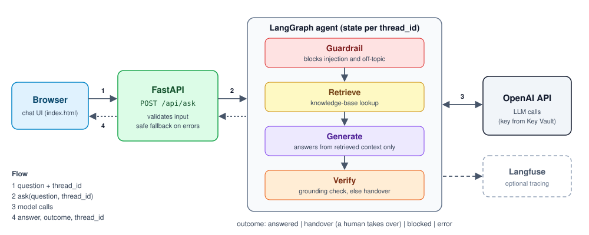
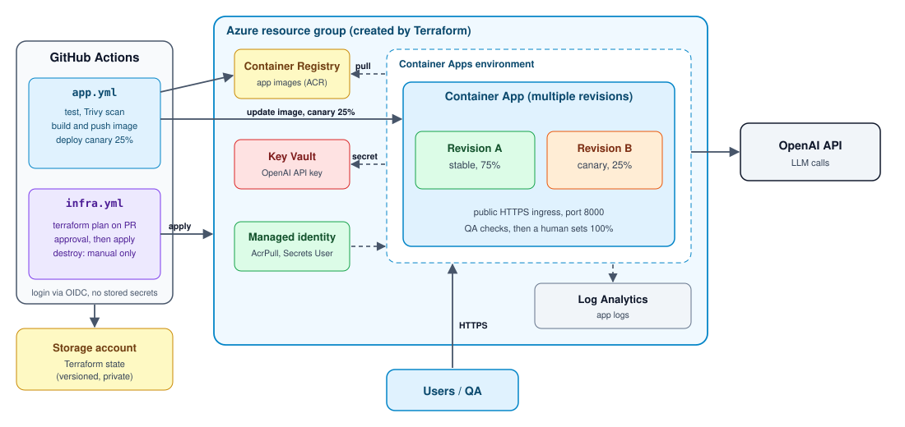
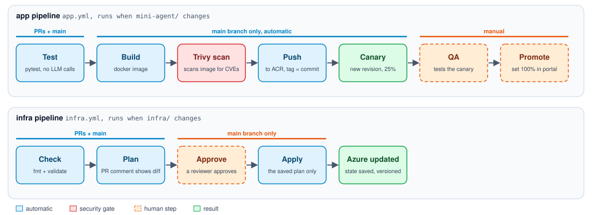

# azure-canary-flask

[](https://github.com/Elyas97/azure-canary-flask/actions/workflows/app.yml)
[](https://github.com/Elyas97/azure-canary-flask/actions/workflows/infra.yml)

A small LLM-powered insurance assistant (FastAPI + LangGraph + OpenAI), shipped to
**Azure Container Apps** with Terraform and GitHub Actions, using **canary releases**.

## How the app works



A question goes through a guardrail, a knowledge-base lookup, an answer generated only from that context, and a grounding check. Anything unsafe or unsupported is blocked or handed to a human instead of guessed. Details in [`mini-agent/README.md`](mini-agent/README.md).

## Cloud architecture



- **Terraform** creates everything: registry, Key Vault, managed identity, Container Apps, logs, and the RBAC between them. State lives in a private, versioned storage account.
- **No passwords anywhere.** GitHub logs in to Azure with OIDC, the app pulls images and reads the OpenAI key through a managed identity, and the key itself lives only in Key Vault.
- Details and setup in [`infra/README.md`](infra/README.md).

## CI/CD



Two pipelines, each triggered only by changes to its own folder: [`app.yml`](.github/workflows/app.yml) ships the app, [`infra.yml`](.github/workflows/infra.yml) manages the Azure resources.

**Release flow:** merge to `main` → canary gets 25% of traffic → QA tests → a human sets the new revision to 100% in the Azure portal (and deactivates the old one).

## Repo layout

```
mini-agent/        FastAPI app, Dockerfile, tests
infra/             Terraform (registry, Key Vault, Container Apps, RBAC)
docs/              diagrams
.github/workflows/ app and infra pipelines
```

## Getting started

1. **Run the app locally:** see [`mini-agent/README.md`](mini-agent/README.md).
2. **Set up Azure and GitHub (state storage, identities, variables):** see [`infra/README.md`](infra/README.md).
3. **Deploy:** push to `main`, approve the infra apply, set the OpenAI key in Key Vault, then let `app.yml` ship the app.
